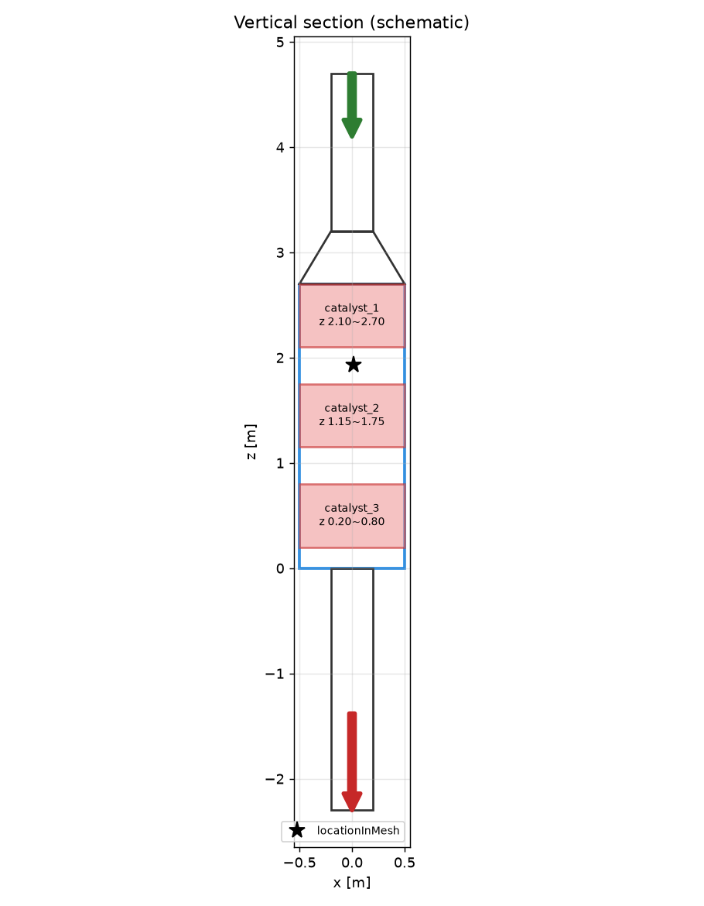
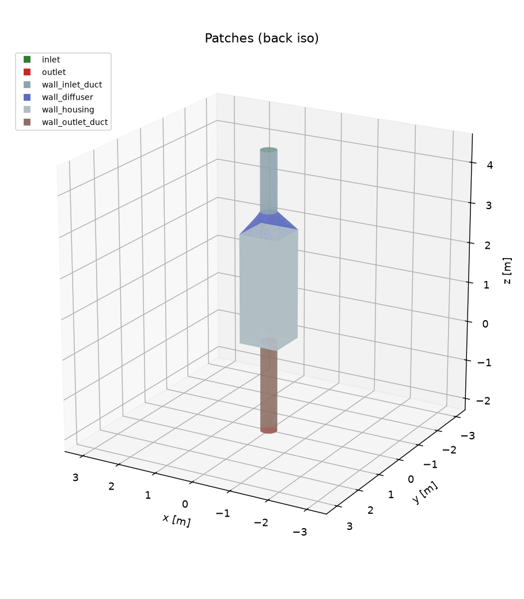

# 형상 체크포인트 보고서 (rev 1)

**판정: PASS**  (FAIL 0, WARN 0)

## 1. 자동 검사

| 결과 | 항목 | 내용 |
|---|---|---|
| ✅ PASS | 패치 이름 spec 일치 | inlet, outlet, wall_inlet_duct, wall_diffuser, wall_housing, wall_outlet_duct |
| ✅ PASS | 닫힌 형상 (watertight) |  |
| ✅ PASS | 법선 방향 일관성 |  |
| ✅ PASS | 법선이 바깥 방향 (부피 > 0) | 3.4248 m³ |
| ✅ PASS | 단일 body | 1개 |
| ✅ PASS | STL 부피 vs CAD 부피 | STL 3.4248 / CAD 3.4252 m³ (오차 0.009%) |
| ✅ PASS | bounding box 일치 | min [-0.5, -0.5, -2.3], max [0.5, 0.5, 4.7] (m) |
| ✅ PASS | 단위 sanity (m) | 최대 길이 7.000 m |
| ℹ️ INFO | 삼각형 변 길이 | min 0.35 mm, max 2879.2 mm |
| ℹ️ INFO | 출구 위치 | 하우징 바닥 [0.0, 0.0], 마지막 촉매층 아래 공간 0.20 m |
| ℹ️ INFO | locationInMesh 후보 | [0.0123, 0.0137, 1.9321] |
| ✅ PASS | OpenFOAM surfaceCheck | closed |

## 2. 패치

| 패치 | 삼각형 수 | 면적 [m²] |
|---|---|---|
| inlet | 124 | 0.1256 |
| outlet | 124 | 0.1256 |
| wall_inlet_duct | 254 | 1.8848 |
| wall_diffuser | 2199 | 1.5667 |
| wall_housing | 139 | 11.6744 |
| wall_outlet_duct | 252 | 2.8900 |

## 3. 가정·추정값 (사용자 확인 필요)

| 항목 | 값 | 상태 | 비고 |
|---|---|---|---|
| inlet_duct.diameter | 0.4 | assumed | PPT에 정보 없음 |
| inlet_duct.length | 0.3 | assumed | 실제 덕트 직관부 길이 |
| inlet_duct.extension | 1.2 | assumed | 해석용 연장 길이 (약 3D) |
| diffuser.height | 0.5 | assumed | PPT에 정보 없음 |
| outlet_duct.center_x | 0.0 | estimated | 스케치상 바닥 중앙 |
| outlet_duct.center_y | 0.0 | estimated |  |
| outlet_duct.length | 0.3 | assumed |  |
| outlet_duct.extension | 2.0 | assumed | 해석용 연장 길이 (약 5D) |
| catalyst_layers[catalyst_1] | None | estimated | 두께 0.6 given, 위치 추정 |
| catalyst_layers[catalyst_2] | None | estimated | 두께 0.6 given, 위치 추정 |
| catalyst_layers[catalyst_3] | None | estimated | 두께 0.6 given, 위치 추정 |

## 4. 미리보기

## 5. 사용자 확인 사항

- [ ] 단면도가 PPT 스케치/실물과 일치하는가 (특히 출구 높이, 촉매층 위치)
- [ ] 3장의 가정·추정값을 실측값으로 교체했거나, 가정으로 진행해도 되는가
- [ ] 패치 구분(색상)이 의도와 일치하는가

승인 시 `01_geometry/GEOMETRY_APPROVED` 파일을 직접 생성하세요. 이 파일이 없으면 격자 단계로 진행하지 않습니다.