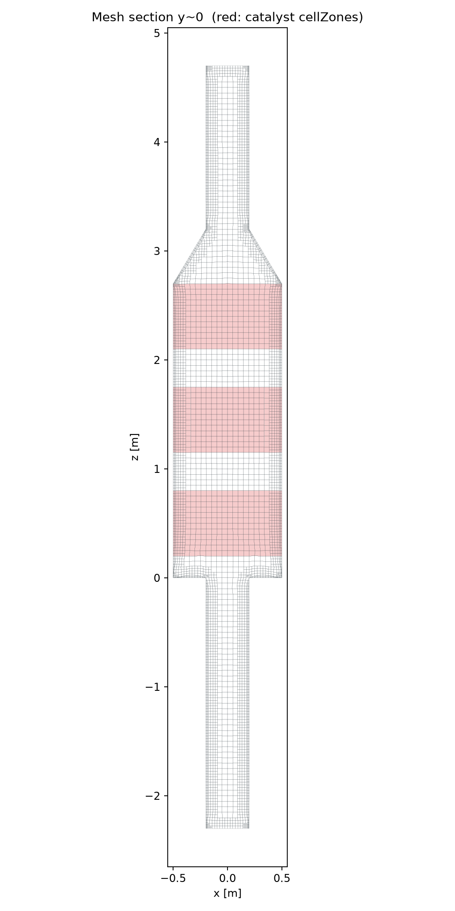
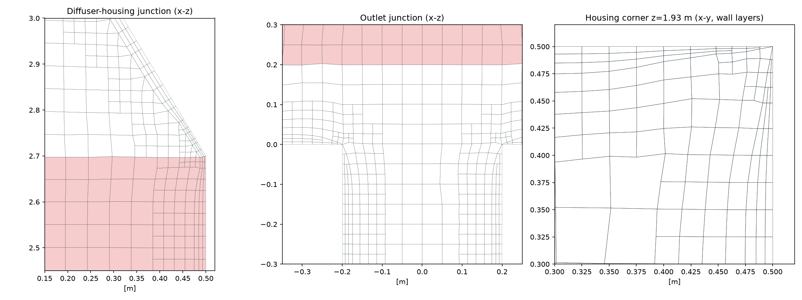

# 격자 체크포인트 보고서 (mesh rev 0, geometry rev 1)

**판정: PASS**  (FAIL 0, WARN 0)

## 1. 요약

- 총 셀 수: **233,884**
- 셀 종류: hexahedra 207,328, prisms 5,605, tet wedges 75, tetrahedra 16, polyhedra 20,860
- 배경 격자: 22×22×142, h = 0.05 m
- 레벨별 셀 수 (셀 크기): L0 15,441 (50.0 mm), L1 164,459 (25.0 mm), L2 53,984 (12.5 mm)

| 지표 | 레이어 전 | 최종 |
|---|---|---|
| 셀 수 | 135,886 | 233,884 |
| max non-ortho | 49.6 | 57.0 |
| max skewness | 2.28 | 2.71 |
| max aspect ratio | 3.8 | 16.2 |

## 2. 자동 검사

| 결과 | 항목 | 내용 |
|---|---|---|
| ✅ PASS | checkMesh 표준 검사 | Mesh OK |
| ✅ PASS | 최대 non-orthogonality | 57.0 (기준 ≤ 65, 평균 7.6) |
| ✅ PASS | 최대 skewness | 2.71 (기준 ≤ 4.0) |
| ✅ PASS | 최소 셀 체적 > 0 | 5.685e-08 m³ |
| ℹ️ INFO | 최대 aspect ratio | 16.2 |
| ✅ PASS | 유체 영역 체적 vs 형상 체적 | 격자 3.4228 / 형상 3.4252 m³ (오차 0.07%) |
| ℹ️ INFO | 추가 검사(-allGeometry) 참고 | ***Cells with small determinant (< 0.001) found, number of cells: 68; ***Concave cells (using face planes) found, number of cells: 11325 → snappy 격자에서 흔한 항목, 판정 제외 |
| ✅ PASS | 패치 이름·타입 일치 | inlet:patch, outlet:patch, wall_inlet_duct:wall, wall_diffuser:wall, wall_housing:wall, wall_outlet_duct:wall |
| ✅ PASS | 레이어 커버리지 wall_inlet_duct | 100% (평균 3.00/3층, 두께 21.0 mm, 기준 ≥ 80%) |
| ✅ PASS | 레이어 커버리지 wall_diffuser | 87% (평균 2.60/3층, 두께 12.9 mm, 기준 ≥ 80%) |
| ✅ PASS | 레이어 커버리지 wall_housing | 88% (평균 2.64/3층, 두께 16.9 mm, 기준 ≥ 80%) |
| ✅ PASS | 레이어 커버리지 wall_outlet_duct | 98% (평균 2.95/3층, 두께 23.0 mm, 기준 ≥ 80%) |
| ✅ PASS | cellZone catalyst_1 | 33,298 cells, 체적 0.5979 / 기대 0.6000 m³ (오차 0.34%), 셀 중심 z 2.104~2.695 (지정 2.1~2.7) |
| ✅ PASS | cellZone catalyst_2 | 29,790 cells, 체적 0.6002 / 기대 0.6000 m³ (오차 0.03%), 셀 중심 z 1.156~1.744 (지정 1.15~1.75) |
| ✅ PASS | cellZone catalyst_3 | 30,139 cells, 체적 0.6000 / 기대 0.6000 m³ (오차 0.00%), 셀 중심 z 0.206~0.794 (지정 0.2~0.8) |

## 3. 패치

| 패치 | 타입 | 면 수 |
|---|---|---|
| inlet | patch | 740 |
| outlet | patch | 740 |
| wall_inlet_duct | wall | 3,384 |
| wall_diffuser | wall | 4,571 |
| wall_housing | wall | 23,712 |
| wall_outlet_duct | wall | 4,483 |

## 4. 단면 그림

## 5. 사용자 확인 사항

- [ ] 단면 그림에서 형상이 제대로 표현되었는가 (덕트, 확장부, 출구 접합부)
- [ ] 촉매층(빨간 영역) 위치와 두께가 의도와 같은가
- [ ] 셀 수와 해상도가 이번 검증 단계에 적절한가 (계산 시간과의 균형)
- [ ] WARN 항목을 이대로 진행해도 되는가

ParaView로 자세히 보려면 Windows ParaView에서 `02_mesh/case/case.foam`을 여세요.
승인 시 `02_mesh/MESH_APPROVED` 파일을 직접 생성하세요. `./Allmesh`를 다시 실행하면 승인은 자동 해제됩니다.