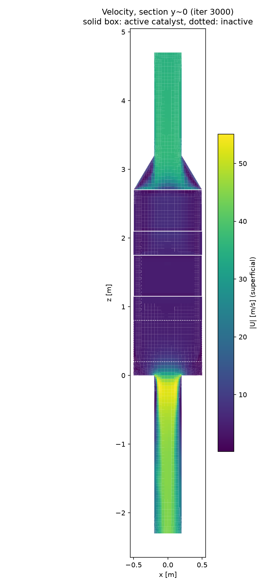
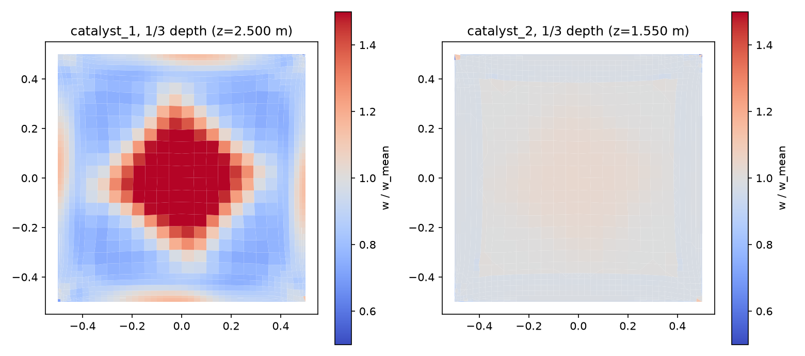
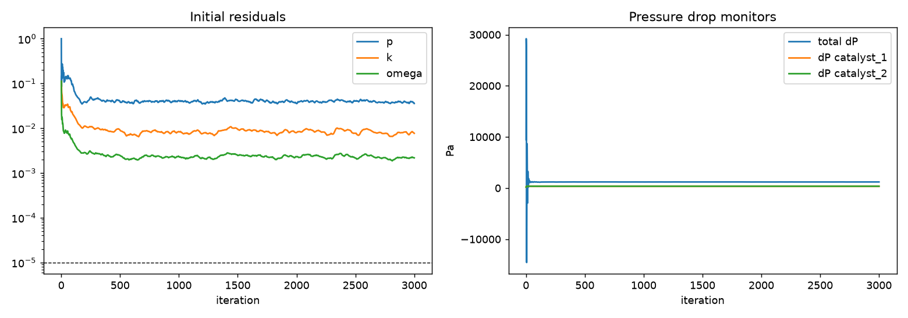

# 유동 계산 보고서: flow_2layer (rev 0, 3-1단계 유동)

**판정: WARN - 확인 필요**  (FAIL 0, WARN 5)

- 시나리오: 1.6 MW 이중연료 엔진, LNG 50% 부하. 검증용 2단 촉매 (3번째 층 촉매 없음)
- 활성 촉매층: catalyst_1, catalyst_2 / 솔버 porousSimpleFoam, 난류 kOmegaSST
- 물성: N2 @ 325 °C, ρ 0.5707 kg/m³, μ 2.905e-05 Pa·s
- 다공성: ε 0.687, d(축) 4.274e+06 1/m², f(축) 9.51 1/m, 가로 ×1e+04
- 하우징 평균 표면속도 4.39 m/s → 촉매 채널 물리 속도 6.39 m/s

## 1. 자동 검사

| 결과 | 항목 | 내용 |
|---|---|---|
| ⚠️ WARN | 반복 수 | 3000 / 최대 3000 |
| ⚠️ WARN | 최종 초기 잔차 | p 3.6e-02, k 7.7e-03, omega 2.2e-03 (목표 1e-05) |
| ✅ PASS | 질량 보존 (입구 vs 출구) | 오차 0.001% |
| ℹ️ INFO | 질량유량 | 2.507 kg/s = 9025 kg/h (입구 35.0 m/s, D 0.4 m) ← 입구 덕트 직경이 가정값 |
| ✅ PASS | 압력손실 catalyst_1 | CFD 333.6 Pa vs 1D 이론 358.6 Pa (차이 -7.0%, 균일 유동 가정) |
| ✅ PASS | 압력손실 catalyst_2 | CFD 350.0 Pa vs 1D 이론 358.6 Pa (차이 -2.4%, 균일 유동 가정) |
| ℹ️ INFO | 전체 압력손실 (입구→출구) | 1193.4 Pa |
| ⚠️ WARN | 모니터 안정성: 전체 ΔP | 마지막 200회 변동 0.96% (기준 ≤ 0.5%) |
| ✅ PASS | 모니터 안정성: ΔP catalyst_1 | 마지막 200회 변동 0.23% (기준 ≤ 0.5%) |
| ✅ PASS | 모니터 안정성: ΔP catalyst_2 | 마지막 200회 변동 0.01% (기준 ≤ 0.5%) |
| ℹ️ INFO | 촉매 유속 균일도 catalyst_1 (층 1/3 깊이) | γ = 0.895, 표면속도 평균 4.38 (최대 7.30, 최소 1.71) m/s |
| ⚠️ WARN | 촉매 내 물리 속도 catalyst_1 | 평균 6.38 m/s, 범위 2.49~10.63 m/s (논문 계수 산출 범위 1.75~3.0 m/s) → 범위 밖이면 다공성 계수 외삽 |
| ℹ️ INFO | 촉매 유속 균일도 catalyst_2 (층 1/3 깊이) | γ = 0.991, 표면속도 평균 4.39 (최대 4.88, 최소 2.35) m/s |
| ⚠️ WARN | 촉매 내 물리 속도 catalyst_2 | 평균 6.39 m/s, 범위 3.41~7.11 m/s (논문 계수 산출 범위 1.75~3.0 m/s) → 범위 밖이면 다공성 계수 외삽 |
| ℹ️ INFO | y+ (min/max/평균) | wall_outlet_duct 22/185/105 → 벽함수 권장 30~300 |

## 2. 촉매층 압력손실

| 층 | CFD [Pa] | 1D 이론 [Pa] | 차이 |
|---|---|---|---|
| catalyst_1 | 333.6 | 358.6 | -7.0% |
| catalyst_2 | 350.0 | 358.6 | -2.4% |

## 3. 촉매 입구 유속 분포

| 층 | 균일도 γ | 표면속도 평균 | 최대 | 최소 | 물리 속도 평균 |
|---|---|---|---|---|---|
| catalyst_1 | 0.895 | 4.38 | 7.30 | 1.71 | 6.38 |
| catalyst_2 | 0.991 | 4.39 | 4.88 | 2.35 | 6.39 |

## 4. 그림

## 5. 검증 메모

- 3-1단계는 반응이 없어 NOx 전환율(측정 88.8~99.7 %) 비교는 3-2단계에서 수행.
- 촉매층 압력손실이 1D 이론값과 가까우면 다공성 계수 변환(d = 1/k, f = 2cF/√k)이 의도대로 적용된 것.

## 6. 사용자 확인 사항

- [ ] 질량유량이 실제 엔진 조건(1.6 MW, LNG 50 % 부하)과 맞는가
- [ ] 촉매 입구 유속 분포가 상식적인가
- [ ] WARN 항목을 이대로 진행해도 되는가