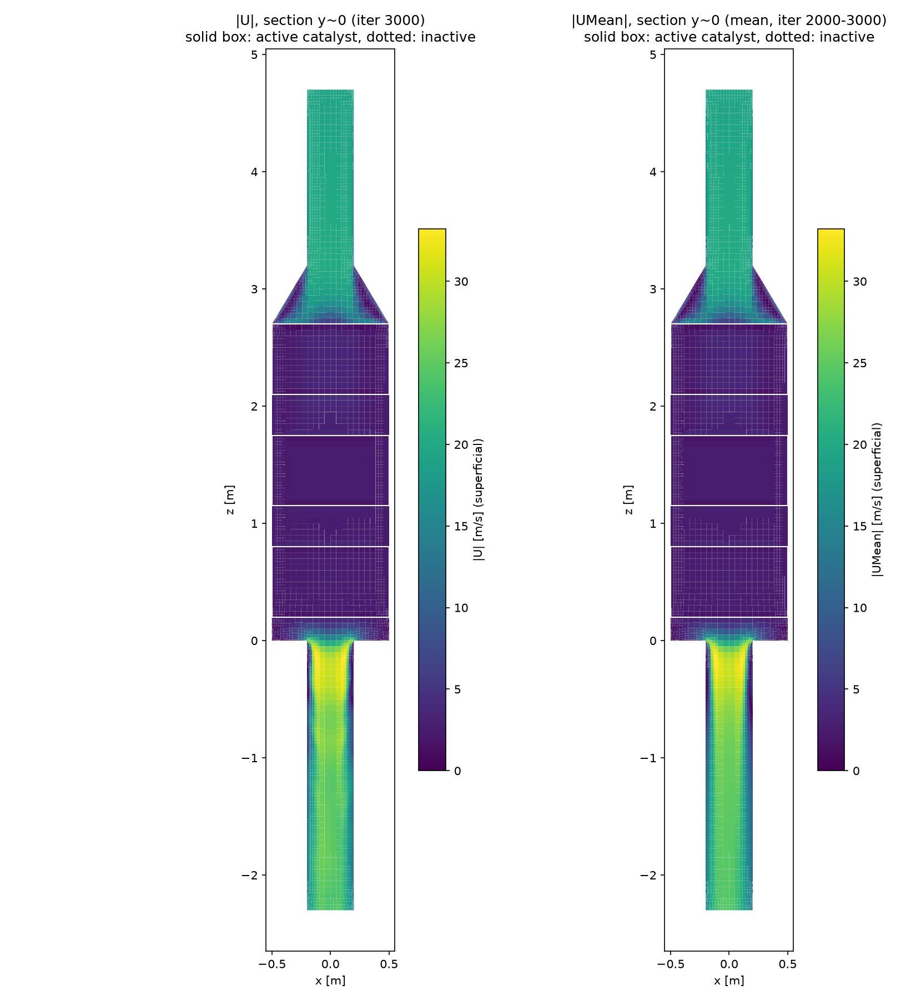
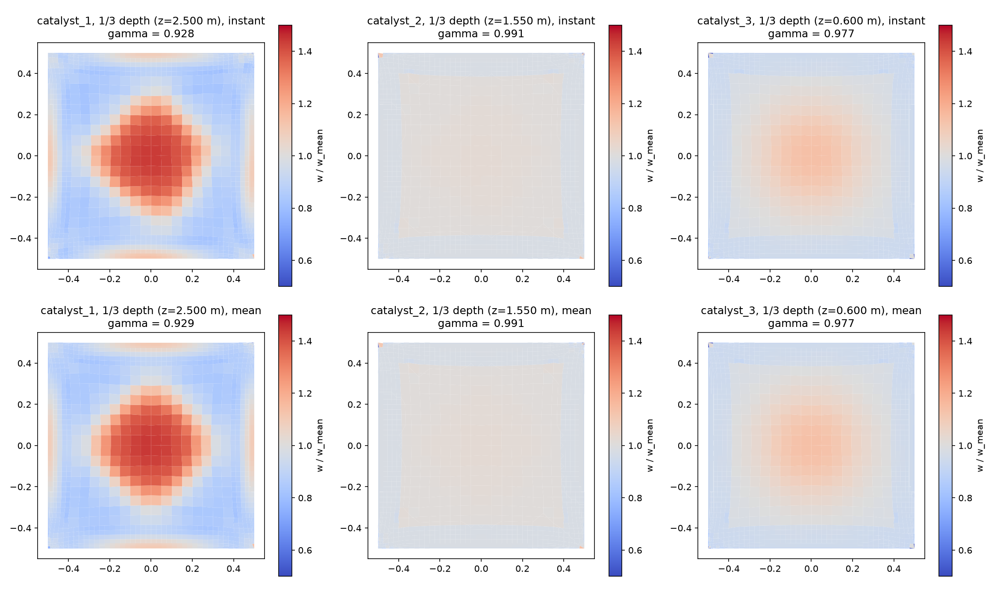
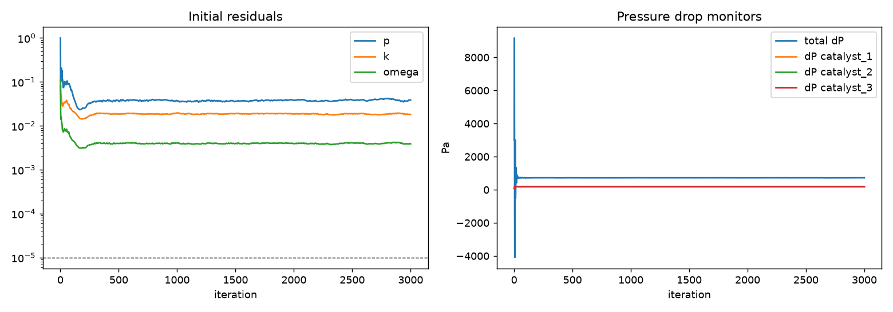
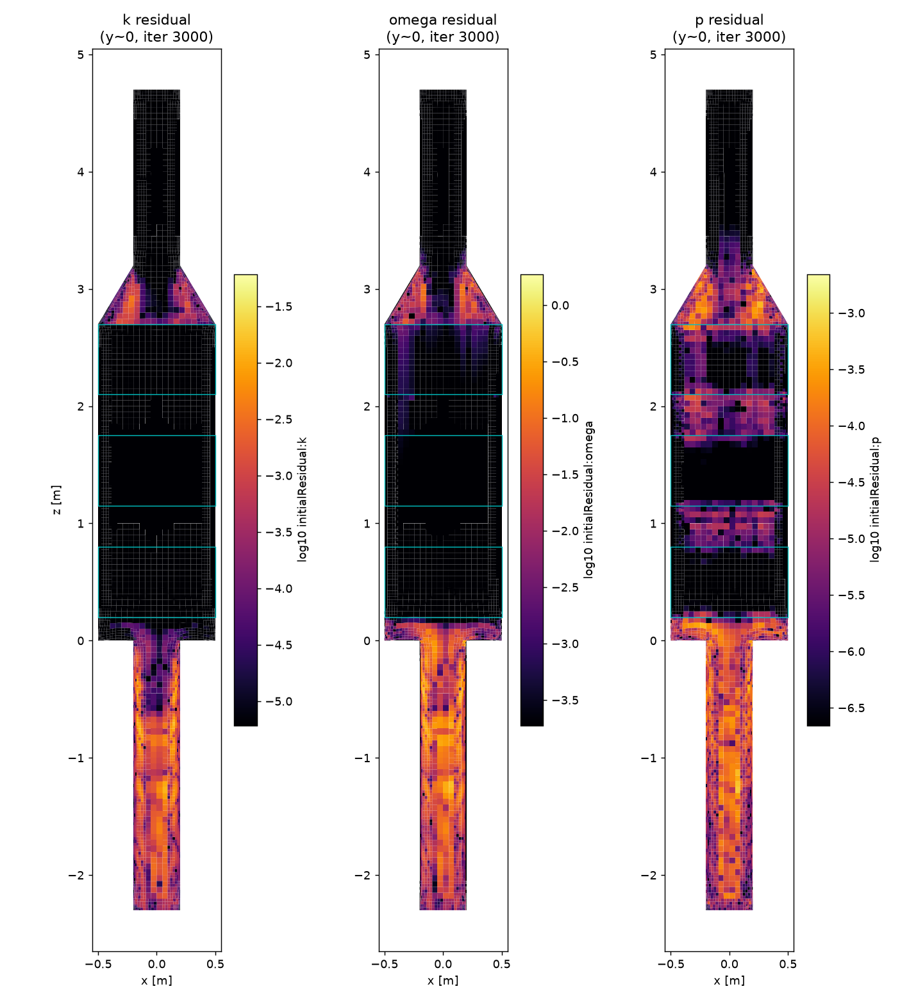

# 유동 계산 보고서: flow_3layer_m5000 (rev 3, 3-1단계 유동)

**판정: WARN - 확인 필요**  (FAIL 0, WARN 3)

- 시나리오: 1.6 MW 이중연료 엔진, LNG 50% 부하. 3단 촉매
- 활성 촉매층: catalyst_1, catalyst_2, catalyst_3 / 솔버 porousSimpleFoam, 난류 kOmegaSST
- 물성: N2 @ 325 °C, ρ 0.5707 kg/m³, μ 2.905e-05 Pa·s
- 다공성: ε 0.687, d(축) 4.274e+06 1/m², f(축) 9.51 1/m, 가로 ×1e+04
- 하우징 평균 표면속도 2.43 m/s → 촉매 채널 물리 속도 3.54 m/s

## 1. 자동 검사

| 결과 | 항목 | 내용 |
|---|---|---|
| ℹ️ INFO | 반복 수 | 3000 / 최대 3000 |
| ℹ️ INFO | 최종 초기 잔차 (참고) | p 3.9e-02, k 1.8e-02, omega 3.9e-03 (솔버 종료 목표 1e-05, 판정 제외) |
| ✅ PASS | 질량 보존 (입구 vs 출구) | 오차 0.001% |
| ℹ️ INFO | 질량유량 | 1.389 kg/s = 5000 kg/h (지정 5000 kg/h, 차이 -0.00%, 입구 19.391 m/s, D 0.4 m) ← 질량유량이 가정값 (case_spec operating.inlet_mass_flow_kg_h) |
| ℹ️ INFO | 모니터 안정성: 전체 ΔP (순간값) | 마지막 200회 변동 0.65% (기준 ≤ 0.5%) → 참고, 순간/평균 차이로 판정 |
| ✅ PASS | 모니터 안정성: ΔP catalyst_1 (순간값) | 마지막 200회 변동 0.07% (기준 ≤ 0.5%) |
| ✅ PASS | 모니터 안정성: ΔP catalyst_2 (순간값) | 마지막 200회 변동 0.00% (기준 ≤ 0.5%) |
| ✅ PASS | 모니터 안정성: ΔP catalyst_3 (순간값) | 마지막 200회 변동 0.00% (기준 ≤ 0.5%) |
| ℹ️ INFO | 판정 기준 필드 | 평균 필드 UMean, pMean 사용 (평균값 (iter 2000~3000)). 순간값과의 비교는 7절 |
| ✅ PASS | 압력손실 catalyst_1 (평균값) | CFD 178.6 Pa vs 1D 이론 190.9 Pa (차이 -6.4%, 균일 유동 가정) |
| ✅ PASS | 압력손실 catalyst_2 (평균값) | CFD 184.5 Pa vs 1D 이론 190.9 Pa (차이 -3.4%, 균일 유동 가정) |
| ✅ PASS | 압력손실 catalyst_3 (평균값) | CFD 185.1 Pa vs 1D 이론 190.9 Pa (차이 -3.1%, 균일 유동 가정) |
| ℹ️ INFO | 전체 압력손실 (입구→출구) (평균값) | 722.5 Pa |
| ℹ️ INFO | 촉매 유속 균일도 catalyst_1 (층 1/3 깊이) (평균값) | γ = 0.929, 표면속도 평균 2.43 (최대 3.50, 최소 0.99) m/s |
| ⚠️ WARN | 촉매 내 물리 속도 catalyst_1 (평균값) | 평균 3.54 m/s, 범위 1.43~5.10 m/s (논문 계수 산출 범위 1.75~3.0 m/s) → 범위 밖이면 다공성 계수 외삽 |
| ℹ️ INFO | 촉매 유속 균일도 catalyst_2 (층 1/3 깊이) (평균값) | γ = 0.991, 표면속도 평균 2.43 (최대 2.78, 최소 1.20) m/s |
| ⚠️ WARN | 촉매 내 물리 속도 catalyst_2 (평균값) | 평균 3.54 m/s, 범위 1.75~4.05 m/s (논문 계수 산출 범위 1.75~3.0 m/s) → 범위 밖이면 다공성 계수 외삽 |
| ℹ️ INFO | 촉매 유속 균일도 catalyst_3 (층 1/3 깊이) (평균값) | γ = 0.977, 표면속도 평균 2.44 (최대 2.77, 최소 0.97) m/s |
| ⚠️ WARN | 촉매 내 물리 속도 catalyst_3 (평균값) | 평균 3.55 m/s, 범위 1.41~4.04 m/s (논문 계수 산출 범위 1.75~3.0 m/s) → 범위 밖이면 다공성 계수 외삽 |
| ✅ PASS | 순간/평균 차이: ΔP catalyst_1 | 0.01% (기준 ≤ 0.5%) |
| ✅ PASS | 순간/평균 차이: ΔP catalyst_2 | 0.00% (기준 ≤ 0.5%) |
| ✅ PASS | 순간/평균 차이: ΔP catalyst_3 | 0.00% (기준 ≤ 0.5%) |
| ✅ PASS | 순간/평균 차이: 전체 ΔP | 0.01% (기준 ≤ 0.5%) |
| ✅ PASS | 순간/평균 차이: 균일도 γ catalyst_1 | 0.02% (기준 ≤ 0.5%) |
| ✅ PASS | 순간/평균 차이: 균일도 γ catalyst_2 | 0.00% (기준 ≤ 0.5%) |
| ✅ PASS | 순간/평균 차이: 균일도 γ catalyst_3 | 0.00% (기준 ≤ 0.5%) |
| ℹ️ INFO | y+ (min/max/평균) | wall_diffuser 3/101/31; wall_housing 0/25/10; wall_inlet_duct 24/67/51; wall_outlet_duct 12/130/65 → 벽함수 권장 30~300 |

## 2. 촉매층 압력손실 (평균값)

| 층 | CFD [Pa] | 1D 이론 [Pa] | 차이 |
|---|---|---|---|
| catalyst_1 | 178.6 | 190.9 | -6.4% |
| catalyst_2 | 184.5 | 190.9 | -3.4% |
| catalyst_3 | 185.1 | 190.9 | -3.1% |

## 3. 촉매 입구 유속 분포 (평균값)

| 층 | 균일도 γ | 표면속도 평균 | 최대 | 최소 | 물리 속도 평균 |
|---|---|---|---|---|---|
| catalyst_1 | 0.929 | 2.43 | 3.50 | 0.99 | 3.54 |
| catalyst_2 | 0.991 | 2.43 | 2.78 | 1.20 | 3.54 |
| catalyst_3 | 0.977 | 2.44 | 2.77 | 0.97 | 3.55 |

## 4. 그림

## 5. 검증 메모

- 3-1단계는 반응이 없어 NOx 전환율(측정 88.8~99.7 %) 비교는 3-2단계에서 수행.
- 촉매층 압력손실이 1D 이론값과 가까우면 다공성 계수 변환(d = 1/k, f = 2cF/√k)이 의도대로 적용된 것.

## 6. 사용자 확인 사항

- [ ] 질량유량이 실제 엔진 조건(1.6 MW, LNG 50 % 부하)과 맞는가
- [ ] 촉매 입구 유속 분포가 상식적인가
- [ ] WARN 항목을 이대로 진행해도 되는가

## 7. 순간값 vs 평균값 (순간값 (iter 3000) / 평균값 (iter 2000~3000))

| 항목 | 순간값 | 평균값 | 차이 (순간-평균) |
|---|---|---|---|
| 균일도 γ catalyst_1 | 0.928 | 0.929 | -0.000 |
| 최대 표면속도 catalyst_1 [m/s] | 3.50 | 3.50 | -0.1% |
| 최소 표면속도 catalyst_1 [m/s] | 0.98 | 0.99 | -0.4% |
| 균일도 γ catalyst_2 | 0.991 | 0.991 | +0.000 |
| 최대 표면속도 catalyst_2 [m/s] | 2.78 | 2.78 | -0.0% |
| 최소 표면속도 catalyst_2 [m/s] | 1.20 | 1.20 | -0.0% |
| 균일도 γ catalyst_3 | 0.977 | 0.977 | +0.000 |
| 최대 표면속도 catalyst_3 [m/s] | 2.77 | 2.77 | -0.0% |
| 최소 표면속도 catalyst_3 [m/s] | 0.97 | 0.97 | -0.0% |
| ΔP catalyst_1 [Pa] | 178.6 | 178.6 | -0.01% |
| ΔP catalyst_2 [Pa] | 184.5 | 184.5 | -0.00% |
| ΔP catalyst_3 [Pa] | 185.1 | 185.1 | -0.00% |
| 전체 ΔP [Pa] | 722.5 | 722.5 | -0.01% |

- 압력손실은 모니터와 같은 평면(촉매층 위/아래 0.4 h)의 면적 평균, 전체 ΔP는 입구/출구 패치 면적 평균.

## 8. 셀별 잔차 분포 (iter 3000, solverInfo initialResidual)

상위 1 % 잔차 셀이 어느 영역에 있는지 (영역별 비율, 합 100 %)

| 필드 | 최대 | 최대 위치 (x, y, z) [m] | 중앙값 | 입구 덕트 | 확장부 | 하우징 | 출구 덕트 |
|---|---|---|---|---|---|---|---|
| k | 6.07e-02 | (-0.100, -0.100, -0.237) | 5.2e-11 | 0% | 1% | 0% | 99% |
| omega | 1.87e+00 | (-0.122, 0.078, -0.237) | 1.3e-05 | 0% | 2% | 0% | 98% |
| p | 2.20e-03 | (0.068, 0.068, -1.325) | 1.0e-07 | 0% | 28% | 3% | 69% |