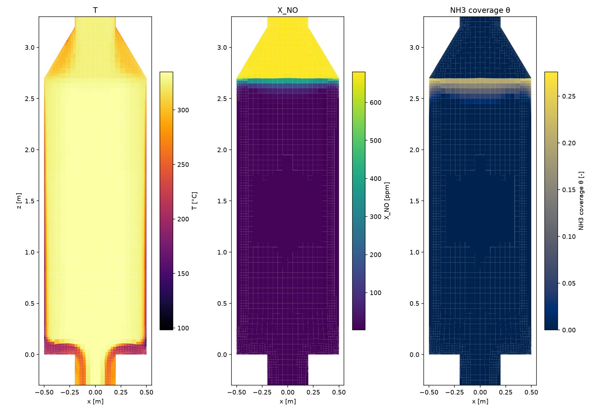
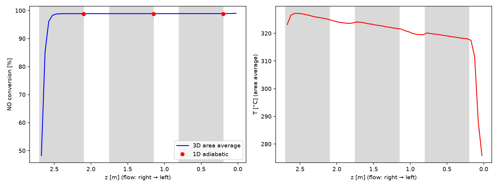
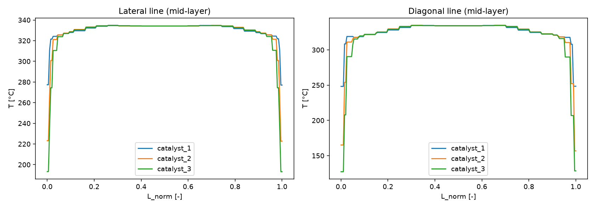
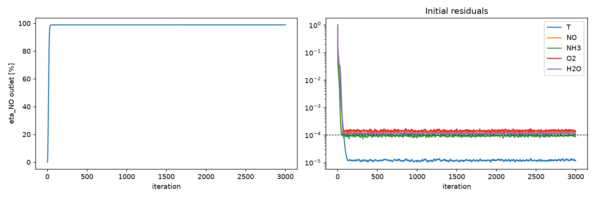

# 열·반응 계산 보고서: react_3layer_m5000 (rev 2, 3-2단계)

**판정: PASS**  (FAIL 0, WARN 0)

- 시나리오: 1.6 MW 이중연료 엔진, LNG 50% 부하. 3단 촉매, Chatterjee 반응 모델
- 유동: flow_3layer_m5000 (iter 3000) 고정, 반응 촉매층: catalyst_1, catalyst_2, catalyst_3
- 반응 모델: chatterjee_coverage (A_SCR 2.2e+08, E_ox 118.0 kJ/mol)
- 입구: 325 °C, NO 680 ppm, NH3 680 ppm, O2 2.0 %, H2O 1.0 %, 질량유량 5000 kg/h

## 1. 자동 검사

| 결과 | 항목 | 내용 |
|---|---|---|
| ✅ PASS | 모니터 안정성 | 마지막 200회 전환율 변동 0.0213 %p, 출구 온도 변동 0.0019 K (기준 < 0.05) |
| ℹ️ INFO | 솔버 종료 조건 | 3000회, 수렴 조건 미달 (최종 잔차 최대 1.3e-04) |
| ✅ PASS | 에너지 수지 | ṁcpΔT -17676.1 W vs 반응열 13703.9 W + 벽 -31379.7 W (오차 0.00% of 반응열) |
| ℹ️ INFO | 벽 열손실 | 31379.7 W (h 10.0 W/m²K, 외기 300.0 K) |
| ✅ PASS | 출구 NO 전환율 (유량 가중) | 98.88 % (측정 88.8~99.7 %) |
| ℹ️ INFO | 출구 NH3 슬립 | 0.000 ppm, 출구 온도 313.16 °C |
| ℹ️ INFO | 마이크로리액터 비교 (1D, Chatterjee 원문 모델 vs 실험 Koo et al. 2016 Fig. 8 fresh) | 최대 차이 -9.57 %p - 판정 없음 (4절 표, CFD-ACE+ 모델 대비 최대 12.57 %p) |
| ℹ️ INFO | catalyst_1 끝 단면 평균 | η_NO 98.89 %, T 324.91 °C (최소 148.3, 최대 335.1), NH3+NH3* 0.00 ppm |
| ℹ️ INFO | catalyst_2 끝 단면 평균 | η_NO 98.89 %, T 321.58 °C (최소 109.2, 최대 334.9), NH3+NH3* 0.00 ppm |
| ℹ️ INFO | catalyst_3 끝 단면 평균 | η_NO 98.91 %, T 317.39 °C (최소 104.5, 최대 334.8), NH3+NH3* 0.00 ppm |
| ✅ PASS | 1D 기준 대비 (단열·균일 유속) | 3D 98.88 % vs 1D 98.78 % (차이 +0.09 %p) - 차이 원인: 유속 불균일(체류시간 분포)과 벽 열손실 |

## 2. 촉매층별 결과 (층 끝 단면 면적 평균, 논문 field-average 방식)

| 층 | η_NO [%] | T 평균 [°C] | T 최소~최대 [°C] | NH3+NH3* [ppm] | 1D 단열 η [%] | 1D T [°C] |
|---|---|---|---|---|---|---|
| catalyst_1 | 98.89 | 324.91 | 148.3~335.1 | 0.00 | 98.78 | 334.18 |
| catalyst_2 | 98.89 | 321.58 | 109.2~334.9 | 0.00 | 98.78 | 334.18 |
| catalyst_3 | 98.91 | 317.39 | 104.5~334.8 | 0.00 | 98.78 | 334.18 |

## 3. 그림

## 4. 마이크로리액터 비교 (1D, 등온, 모델: chatterjee_coverage)

| T [°C] | U [m/s] | 실험 [%] | CFD-ACE+ [%] | 1D [%] | 1D − 실험 [%p] | 1D − CFD-ACE+ [%p] |
|---|---|---|---|---|---|---|
| 230 | 1.075 | 77.0 | 80.0 | 67.4 | -9.57 | -12.57 |
| 260 | 1.139 | 90.0 | 89.4 | 90.9 | +0.93 | +1.53 |
| 300 | 1.224 | 97.0 | 95.2 | 98.6 | +1.56 | +3.36 |
| 350 | 1.331 | 99.0 | 97.8 | 97.9 | -1.14 | +0.06 |
| 400 | 1.438 | 99.0 | 98.3 | 96.2 | -2.77 | -2.07 |
| 430 | 1.502 | 99.0 | 97.9 | 94.7 | -4.34 | -3.24 |

- 실험: Koo et al. (2016) Figure 8, fresh (사용자 digitizing). chatterjee_coverage는 실험 대비 차이만 보고 (판정 없음).

## 5. 확인 필요한 가정·추정값

| 항목 | 값 | 상태 | 비고 |
|---|---|---|---|
| gas.inlet_mole_fraction.O2 | 0.02 | assumed | 논문 전체규모 계산값 |
| gas.inlet_mole_fraction.H2O | 0.01 | assumed | 논문 전체규모 계산값 |
| gas.M_mix_gmol | 27.99 | assumed | 위 조성 + N2 잔여로 계산 |
| gas.cp | 1075.0 | assumed | J/kgK, N2 @ 600 K |
| gas.lambdaF | 0.044 | assumed | W/mK, N2 @ 600 K |
| gas.Dm | 5.4e-05 | assumed | m2/s, NO·NH3의 N2 중 분자확산계수 @ 600 K |
| catalyst.kinetics.source | Chatterjee et al. Appendix B Table 6 | estimated | 원문 표는 회귀값의 '대략적 크기(order of magnitude)'. Baek 논문은 E_ox를 141.6 kJ/mol(118의 1.2배)로 수정 |
| catalyst.kinetics.solid_fraction | 0.313 | assumed | chatterjee: 촉매 부피당 속도를 반응기 부피당으로 환산하는 계수 = 1-ε. 확인 필요 |
| catalyst.kinetics.dH2_kJmol | 316.8 | assumed | NH3 산화 반응열, NH3 1 mol당 (표준 생성 엔탈피) |
| catalyst.kinetics.dH3_kJmol | 407.1 | assumed | 표준 SCR 반응열, NO 1 mol당 (표준 생성 엔탈피) |
| parallel.n_procs | 6 | assumed |  |
| validation.microreactor.catalyst_length | 0.0952 | estimated | U_N과 면적속도 25 m/h, sV 882에서 역산 (L = U_N·3600/(AV·sV)) |

## 6. 검증 메모

- 에너지 수지는 솔버 구현 점검용: 출구 엔탈피 증가 = 반응열(출구 농도 변화로 역산) + 벽 열손실.
- 1D 기준은 같은 반응식을 단열·균일 유속으로 적분한 값. 3D와 수 %p 이내면 구현이 일관된 것.
- 측정 전환율(88.8~99.7 %)은 실제 엔진 3단 촉매 기준이므로 2단 결과와의 비교는 참고용.